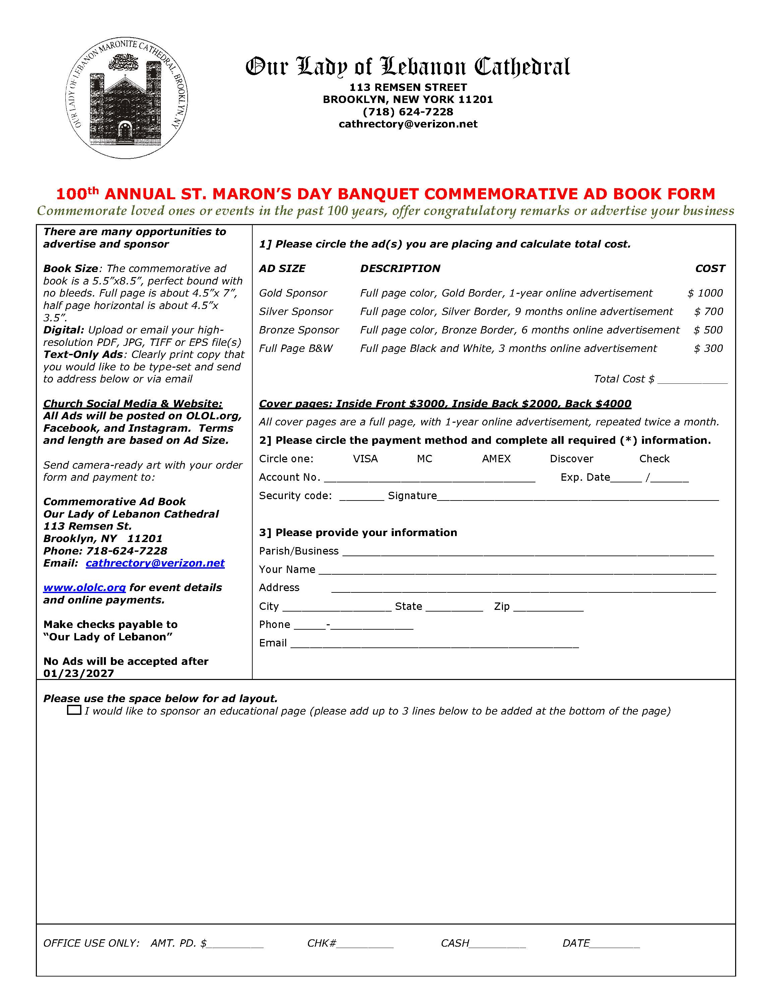

## Please join us for our 100th Annual St. Maron Day Gala.

*Where:* [Giando on the Water](https://www.giandoonthewater.com/)  
*When:* 7pm, Saturday, February 6, 2027

🍸 7pm Cocktail hour followed by Dinner, Dancing and Raffle.  
🎵 Entertainment by Kalem Issa.  
Tickets: $3,000 VIP table; or $200 per person.


  


or for reservations, contact

* Darine Safi (347) 336-5265
* Georges Elhaje (646) 691-9925



Place your congratulatory remarks, remember your deceased family members, and/or advertise your business in our *Commemorative Ad Book*.

Click on the form below to download.  Send your completed form to cathrectory@verizon.net.
Contact Mike Naber (917) 612-4004 if you have any questions.

